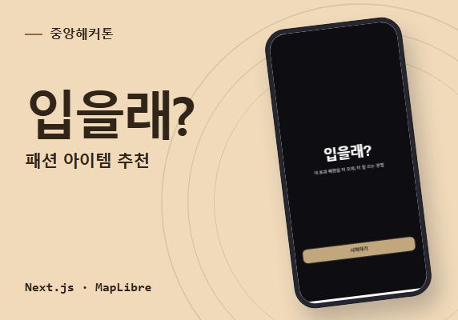
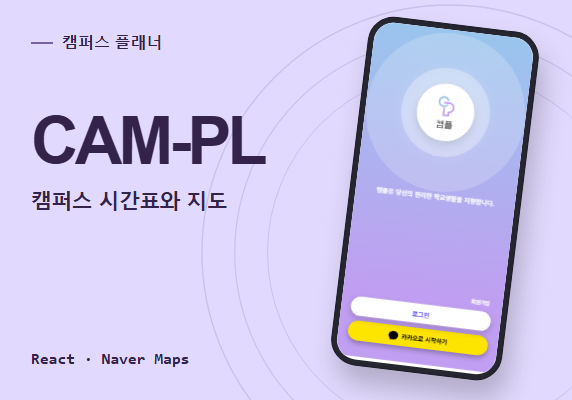
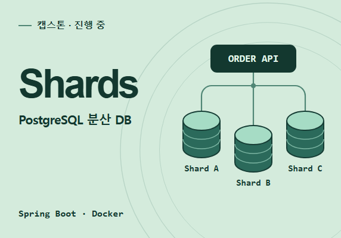

  
  

    
    
    
  

## 개인 소개

**더 나은 서비스, 기술을 만드는 김형석입니다.**  
프론트엔드에서 시작해 Java와 Spring Boot로 백엔드를 공부하고 있습니다.  웹 서비스의 화면과 API를 함께 개발하는 풀스택 개발자가 되어, 서버 운영과 보안 인프라 관리까지 경험하길 바라고 있습니다.

## 개발할 때 중요하게 생각하는 것

- **프론트엔드** · 누가 어떤 상황에서 서비스를 쓰는지 먼저 정의하고 그 사용자가 원하는 일을 쉽게 마칠 수 있도록 화면과 이용 흐름을 설계합니다.  여러 라이브러리를 적극적으로 활용하며 코드를 너무 무겁지 않게, 유지 보수가 편리하도록 구성하는 것에 신경썼습니다.
- **백엔드** · 완벽한 보안은 없다는 전제에서 취약점과 그 영향을 줄이는 설계를 지향합니다. 불필요한 요청을 줄이고 트래픽을 분산해 서버 부하를 낮추는 방법을 고민했습니다.
- **서버 인프라** · 서비스를 안정적으로 운영하고, 장애가 생겼을 때 빠르게 원인을 파악해 복구할 수 있는 서버 환경을 구축하고 싶습니다.
- **AI 활용** · AI가 제안한 코드의 동작 원리를 이해하고 직접 검증한 뒤 적용합니다.

### 기술 스택과 도구

| 분야 | 사용하는 기술과 도구 |
| :--- | :--- |
| **프론트엔드** |   |
| **백엔드** |   |
| **데이터베이스** |    |
| **컨테이너 · 운영체제** |   |
| **AI 도구** |   |
| **정보보안 학습** |   |

### 활동

| 시기 | 경험 |
| :--- | :--- |
| **고등학교 3년** | 로봇공학 중점 고등학교에서 아두이노를 배우고, 코딩 동아리에서 활동했습니다. CodeUp으로 C 언어 문제를 풀며 기초를 익혔습니다. |
| **2025 · 멋쟁이사자처럼 대학 아기사자** | 대학교에 입학한 뒤 전국 연합 동아리 멋쟁이사자처럼의 프론트엔드 팀에서 웹 개발의 기본 개념을 배웠습니다. |
| **2026 · 멋쟁이사자처럼 대학 프론트엔드 팀장** | 1학기 동안 매주 화요일 세션을 열어 학생들에게 프론트엔드 기초를 가르쳤습니다. `fetch` 실습에서는 학생들이 브라우저에서 실제로 요청을 보내고 응답을 확인할 수 있도록 API와 DB를 구성했습니다. |
| **현재** | 실습용 API를 만들며 백엔드에 관심을 갖게 됐습니다. Spring Boot로 서버 개발을 공부하면서 포너블(Pwnable)과 웹 보안도 함께 학습하고 있습니다. |

---

## 프로젝트 소개

  
  
   
  
  

| 프로젝트 · 개발 기록 | 서비스 소개 | 링크 |
| :--- | :--- | :---: |
| **CheChe** 2026.09–10 국민체육진흥공단 공공데이터 활용 경진대회 | 지역의 공공체육시설을 찾아 요금과 시간대별 잔여 인원을 확인하고 예약하는 서비스입니다. 관리자는 시설 손상 사진을 등록하고 점검 결과와 후속 조치를 관리할 수 있습니다. `Next.js` `TypeScript` `Tailwind CSS` |  |
| **입을래?** 2026.07–08 멋쟁이사자처럼 14기 중앙해커톤 | 취향과 옷장에 있는 아이템을 바탕으로 MCM 제품을 추천하는 모바일 웹입니다. 사진으로 보유 아이템을 등록하고, 구매 전 활용 가능성과 코디에 어울리는 장소를 확인할 수 있습니다. `Next.js` `TypeScript` `Zustand` `MapLibre` |  |
| **CAM-PL** 2025.11–12 캠퍼스 생활 플래너 | 강의 시간표, 캠퍼스 지도, 캘린더를 한곳에 모은 웹 서비스입니다. 시간표에서 강의동 위치를 확인하고, 학사 일정과 개인 일정을 함께 살펴볼 수 있습니다. `React` `Naver Maps API` `Nginx` |  |
| **Shards** 2026.10–현재 분산 DB 캡스톤 · 진행 중 | 주문 데이터를 여러 PostgreSQL DB에 분산하고, 사용자 ID로 주문이 저장될 샤드를 찾습니다. 샤드별 조회 결과를 합쳐 최신 주문을 페이지 단위로 제공하며, 일부 DB의 연결이 끊겼을 때 `503`을 반환하는 테스트가 있습니다. 버킷 재배치 작업 등록을 구현했고 실제 데이터 이동을 개발 중입니다. `Java` `Spring Boot` `PostgreSQL` `Docker` |  |

<strong>프로젝트 더 보기 · 올담 / 너랑나랑 / 담다</strong>

| 프로젝트 · 개발 기록 | 서비스 소개 | 링크 |
| :--- | :--- | :---: |
| **올담(alldam)** 2026.05–07 | 충남 지역 시설을 지도에서 찾는 공공데이터 프로젝트입니다. 서산·당진·홍성·예산의 터미널 위치와 주소를 지역별로 확인할 수 있습니다. |  |
| **너랑나랑(UandMe)** 2025.09 | 성향 질문을 바탕으로 프로필을 만들고, 상대에게 호감을 표시하거나 채팅할 수 있는 매칭 웹앱입니다. 1300명의 사용자를 확보했었습니다. |  |
| **담다(DAMDA)** 2025.07 · 멋사 미니해커톤 | 여행지를 탐색하고 여행 기록을 작성하는 React 웹 프로토타입입니다. 첫 정규 프로젝트 진행이었습니다. |  |

개발 기록은 공개 저장소에서 확인한 월을 기준으로 표기했습니다.

### 오픈소스 기여

| 프로젝트 | 변경 내용 | 링크 |
| :--- | :--- | :---: |
| **v2hub-panel** | 구독 소스를 수정하고 저장하면 생성된 설정 수 대신 소스 수가 표시되던 오류를 수정했습니다. 저장 API 응답에서 실제 설정 수를 읽도록 변경했습니다. |  |
| **hercycle-ai** | 모바일 온보딩 창의 닫기 버튼에 **44×44px** 터치 영역과 스크린 리더용 이름을 추가했습니다. |  |
