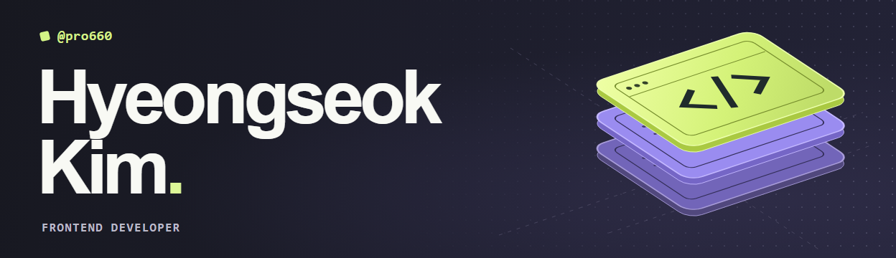
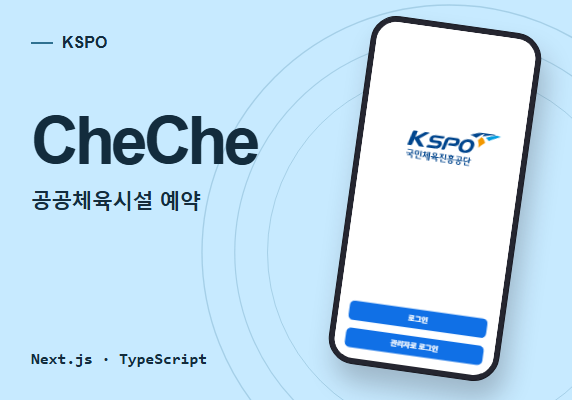

  

  <strong>React와 Next.js로 모바일 웹을 만드는 김형석입니다.</strong> 
  Java와 Spring Boot로 서버 개발을 공부하며 풀스택 개발자를 준비하고 있습니다. 
  <a href="mailto:gw904202@gmail.com">gw904202@gmail.com</a>

  
  
  
  
  
  

## 대표 프로젝트

  
  
  

| 프로젝트 | 내가 맡은 일 |
| --- | --- |
| **CheChe** · KSPO 공공데이터 활용 경진대회 | 시설 예약 화면을 개발했습니다. 예약이 겹치면 최신 시간표를 다시 불러와 다른 시간을 선택할 수 있게 했습니다. [예약 처리 코드](https://github.com/pro660/KSPO/blob/main/src/screens/reservations.tsx) |
| **입을래?** · 멋사 중앙해커톤 | 사진을 올리면 AI 분석 결과가 아이템 등록 폼에 채워지도록 구현했습니다. 사진 연결이 실패하면 사진만 다시 올릴 수 있습니다. [구현 PR](https://github.com/pro660/Hackathon_FE/pull/14) |
| **CAM-PL** · 3인 팀 프론트엔드 | 시간표의 수업과 네이버 지도를 연결해 강의동을 찾을 수 있게 했고, 빌드부터 Nginx 재배포까지 스크립트로 묶었습니다. [담당 역할](https://github.com/pro660/CAM-PL-FE#readme) |

<strong>입을래? 개발 화면 보기</strong>

  
  

[화면과 변경 코드가 담긴 PR #11](https://github.com/pro660/Hackathon_FE/pull/11)

<strong>다른 프로젝트 · 올담 / 너랑나랑 / 담다</strong>

- **올담** · 충남 4개 시·군의 터미널 데이터를 조회해 카카오 지도에 표시했습니다. [저장소](https://github.com/pro660/alldam)
- **너랑나랑** · 가입 정보와 성향 질문 10개의 답변을 프로필에 저장하고 결과 화면으로 연결했습니다. [질문 화면 코드](https://github.com/pro660/UandMe/blob/master/src/jsx/signup/QPage.jsx)
- **담다** · 멋사 미니해커톤에서 첫 React 팀 프로젝트로 여행 기록 웹 프로토타입 제작에 참여했습니다. [저장소](https://github.com/pro660/Likelion_Minihackathon)

## 활동과 오픈소스

**한서대학교 멋쟁이사자처럼 · 프론트엔드 팀장**  
1학기 동안 매주 화요일 세션을 진행하며 학생들에게 프론트엔드 기초를 가르쳤습니다.

- **v2hub-panel** · 소스 2개에서 생성된 설정 11개가 저장 직후 2개로 표시되던 오류를 수정했습니다. [병합된 PR #2](https://github.com/nestthub/v2hub-panel/pull/2)
- **hercycle-ai** · 모바일 닫기 버튼의 터치 영역을 44×44px로 넓히고 스크린 리더가 읽을 이름을 추가했습니다. [병합된 PR #415](https://github.com/khushi897920-lang/hercycle-ai/pull/415)

## 요즘 공부하는 것

- **백엔드** · 여러 PostgreSQL DB에 나뉜 주문을 최신순으로 합치는 Spring Boot API를 개발하고 있습니다. [주문 조회 코드](https://github.com/pro660/Shards/blob/main/src/main/java/com/example/shards/order/OrderQueryService.java) · [일부 DB 연결 실패 테스트](https://github.com/pro660/Shards/blob/main/src/test/java/com/example/shards/order/OrderQueryFailureTest.java)
- **정보보안** · Dreamhack 워게임을 풀며 메모리 구조와 프로그램의 동작을 공부하고 있습니다.
